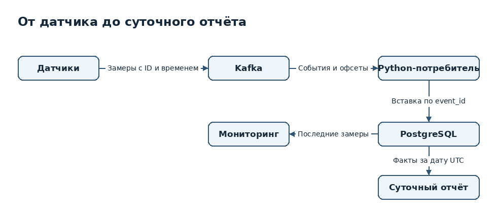

# Отчёт по практической №2

## 1. Вариант и задача

| Поле | Значение |
|---|---|
| ФИО | Мамий Самир Оскарович |
| Тема | Вариант 2 — «Поток событий без потерь (Streaming vs Batch)» |
| Состав решения | Датчики, Kafka, Python-потребитель, PostgreSQL, мониторинг и суточные отчёты |
| Данные, объём | Учебная оценка: 100 датчиков, замер каждые 10 секунд, около 864 000 событий в сутки. Поля: ID события, ID датчика, время UTC, температура. |

## 2. Источники и способы сбора

| Источник | Тип | Способ сбора |
|---|---|---|
| Датчики температуры | Поток | Агент сохраняет замеры локально до подтверждения Kafka и повторяет отправку с тем же ID после сбоя связи. |
| Таблица уникальных измерений | Batch | Суточная задача читает измерения за нужную дату и заново считает число замеров и среднюю температуру. |

## 3. Архитектура



Исходник схемы находится в `architecture.drawio`.

Выбираю Kappa: один поток поступления и одна таблица фактов. Суточный расчёт читает уже обработанные факты. В Lambda потребовалось бы поддерживать две ветки обработки сырого входа и согласовывать результаты. Здесь мониторинг и отчёт используют одни и те же замеры.

Движок — Python-потребитель Kafka. Для выбранного сценария ему нужны вставка и простые SQL-запросы. Flink или Spark имеет смысл рассмотреть при росте нагрузки и появлении сложных оконных расчётов. PostgreSQL хранит уникальные факты и даёт доступ к оперативному и суточному представлению.

## 4. Docker — что поднялось

| Блок | Статус |
|---|---|
| Датчики | Реализован генератор трёх учебных событий с повторной доставкой одного из них. |
| Kafka | Спроектирована. |
| Потоковый обработчик | Реализована последовательная обработка событий с защитой от дублей. |
| PostgreSQL | Спроектирован. В демо ту же роль выполняет SQLite с файлом в Docker-томе. |
| Мониторинг и отчёт | Реализованы SQL-запросами. Результат печатается в журнал. |

Запуск проверен на Mac через Docker Compose. Compose скачал образ, создал сеть и том для SQLite. Контейнер выполнил сценарий и завершился с кодом 0.

```bash
docker compose up -d
docker compose ps -a
docker compose logs demo
```

Строка контейнера из `docker compose ps -a` (основные столбцы):

```text
NAME                         IMAGE              SERVICE  STATUS
practice-2-variant-2-demo-1   python:3.12-slim   demo     Exited (0) Less than a second ago
```

Вывод `docker compose logs demo`:

```text
demo-1  | Первое событие: сохранено
demo-1  | Следующий день: сохранено
demo-1  | Отчёт до поздней доставки: (1, 20.0)
demo-1  | Позднее событие: сохранено
demo-1  | Отчёт после поздней доставки: (2, 22.0)
demo-1  | Последнее показание: ('demo-2', 30.0)
```

## 5. Описание

| Шаг | Для чего | Результат |
|---|---|---|
| Датчик отправляет замер | Доставить исходное событие | ID создаётся один раз, время берётся в момент измерения. |
| Kafka хранит сообщения | Дать обработчику возможность повторно прочитать вход | Репликация, подтверждение всех синхронных реплик и retention на время восстановления. Офсеты отслеживаются по разделам. |
| Потребитель пишет факт и подтверждает офсет | Пережить перезапуск без двойного учёта | Факт фиксируется транзакцией. Офсет сохраняется после коммита БД. Повтор после сбоя упирается в уникальный ключ event_id. |
| Мониторинг запрашивает последнее показание | Видеть актуальный замер каждого датчика | Выбирается наибольший event-time. Запоздавший старый замер не перезаписывает показание. |
| Суточная задача перечитывает факты | Получить точный отчёт с учётом опозданий | Запрос берёт полуоткрытый интервал UTC. Поздние события запускают пересчёт своей даты. Итог заменяется целиком по ключу даты. |

**Время.** Event-time определяет сутки и порядок показаний датчика. Processing-time нужен для наблюдения за задержкой. Отчёт после полуночи предварительный и пересчитывается при поступлении старых замеров. Для подтверждения полноты можно сверять последовательные номера и отметки завершения суток по каждому датчику. При произвольной задержке сам факт наступления полуночи полноту не подтверждает.

**Опоздания и повторы.** В проекте сохраняются все корректные уникальные факты, включая события за уже рассчитанные дни. В промышленной версии дату для пересчёта следует записывать в очередь PostgreSQL в той же транзакции, что и факт. Вариант для оконного мониторинга во Flink — watermark для оперативных результатов и отдельная обработка событий за пределами окна. Дедупликация только в памяти с TTL подходит для ограниченного интервала, а уникальный ключ в БД работает и при повторном чтении старых данных. Конфликт содержимого с тем же ID требует отдельной записи об ошибке и разбора. Демо обнаруживает конфликт и завершает обработку с ошибкой.

**Границы гарантии.** Восстановление опирается на локальный буфер источника и доступность сохранённых сообщений до подтверждения обработки. При проектировании нужно задать retention с запасом и отслеживать отставание потребителя.

## 6. Выводы

В тесте первое событие пришло в 22:00, затем поступило показание за следующие сутки. Повтор первого события оставил один факт. Замер за 18:00 доставлен последним и изменил отчёт прошлых суток с одного измерения со средней 20 °C до двух со средней 22 °C. Мониторинг сохранил показание 30 °C за следующие сутки.

### Мой любимый десерт

Тирамису. Мне нравится сочетание мягкого крема и лёгкой кофейной горчинки.
